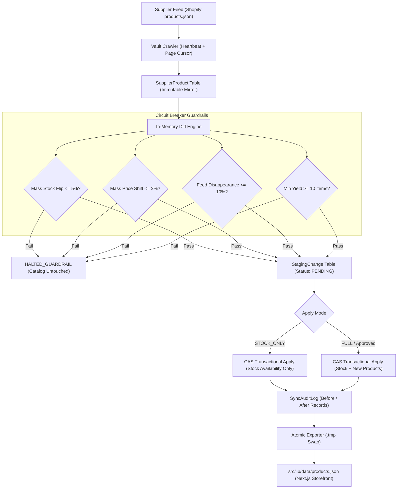

# Ekora Bazaar - Enterprise Crawl Vault, Stock Verification & Catalog Intake Engine

An enterprise-grade, transactional synchronization and stock verification engine for [Ekora Bazaar](https://github.com/Prabhleen114/ekorabazaar). Built around an immutable staging vault so that a killed, interrupted, or buggy crawl **can never corrupt live storefront data or overwrite live catalog prices**.

```
Crawler (Shopify/WooCommerce)
       │
       ▼
[ SupplierProduct Vault ] (Immutable Mirror: externalProductId + externalVariantId)
       │
       ▼
[ In-Memory Diff Engine ] (contentHash != appliedHash)
       │
       ▼
[ Circuit Breakers ] (Stock Flips <= 5%, Price Shifts <= 2%, Disappearance <= 10%, Yield >= 10)
       │
       ├─────────────────────────────────┐
       ▼                                 ▼
[ StagingChange ] (Pending Review)   [ Transactional Apply Engine ] (CAS on Product.version)
                                         │
                                         ├──> Product Table (PostgreSQL)
                                         ├──> SyncAuditLog (Immutable change ledger)
                                         └──> products.json (Atomic read-only .tmp export)
```

---

## Table of Contents

- [Core Architectural Principles](#core-architectural-principles)
- [Pipeline Flowchart](#pipeline-flowchart)
- [Features](#features)
- [Circuit Breaker Guardrails](#circuit-breaker-guardrails)
- [Field Ownership Matrix](#field-ownership-matrix)
- [How to Work This Repo (CLI Guide)](#how-to-work-this-repo-cli-guide)
  - [1. Dry Run / Diff Only](#1-dry-run--diff-only)
  - [2. Safe Stock-Only Sync](#2-safe-stock-only-sync)
  - [3. 1-Click Instant Rollback](#3-1-click-instant-rollback)
  - [4. Web Management Dashboard](#4-web-management-dashboard)
- [Directory Structure](#directory-structure)
- [Database Schema (Vault Tables)](#database-schema-vault-tables)
- [Safety Rules & Constraints](#safety-rules--constraints)

---

## Core Architectural Principles

1. **The Crawler Never Writes to Live Tables**:
   - The crawler only writes to `SupplierProduct` (an immutable mirror of external supplier feeds) and `CrawlRun` (the run ledger).
   - Live `Product` rows and customer-facing storefront files are completely isolated from crawler code.
2. **Shopify Multi-Variant Extraction**:
   - Every product variant (Color, MOQ pack size, dimension) is unpacked into its own discrete record keyed by `(supplierKey, externalProductId, externalVariantId)`.
   - Never matches on volatile handles or loose titles.
3. **Immutable Content Hashing**:
   - Compares current supplier hash (`contentHash`) against the last applied hash (`appliedHash`).
   - If nothing changed at the supplier, zero database writes or diff calculations occur.
4. **Compare-and-Swap (CAS) Version Control**:
   - Live products maintain a monotonic `version` integer.
   - During the apply phase, updates only proceed if `liveProduct.version === stagedChange.before.version`. If an admin modified the item in the meantime, the sync yields a non-destructive `CONFLICT` rather than overwriting manual edits.
5. **Circuit Breakers (Automated Safety Halts)**:
   - If abnormal stock flips, mass price deviations, or feed disappearances are detected, the pipeline automatically halts and refuses to apply changes to the live store.
6. **1-Click Rollback**:
   - Every applied change writes a before/after snapshot to `SyncAuditLog`.
   - Running `--revert=RUN_ID` replays the audit log in reverse and restores both PostgreSQL and `products.json` to their exact pre-sync state.
7. **Flat-File `products.json` Retired as Write Target**:
   - PostgreSQL is the single source of truth.
   - `src/lib/data/products.json` is generated read-only via atomic `.tmp` file swap at build time or after approved syncs.

---

## Pipeline Flowchart



---

## Features

- **Multi-Variant Ingestion**: Extracts all colors and MOQ pack sizes (e.g., 20 discrete variants for sliding tin containers across Silver, Black, Rose Gold, White, Blue × 12PCS, 108PCS, 204PCS, 500PCS) with individual SKUs, prices, and availability.
- **Strict Fragrance Oil & Wax Filter**: Prohibits automated intake of fragrance oils, scent oils, aroma oils, perfume oils, and candle waxes.
- **Canonical 38-Category Taxonomy**: Auto-classifies new items into Ekora Bazaar's 38 official canonical categories (`Category` table with foreign key linkage).
- **Concurrency Locking**: PostgreSQL partial unique index `crawlrun_one_running` guarantees two crawls can never overlap or conflict behind connection poolers.
- **Two-Misses Discontinuation Rule**: Only marks a product discontinued if it is absent in two consecutive crawl runs (`consecutiveMisses >= 2`).
- **Field Locking Support**: Honors `Product.lockedFields`. Fields locked by an admin (e.g. custom pricing or descriptions) are never modified by the sync engine.

---

## Circuit Breaker Guardrails

Before any change can touch live data, the Diff Engine evaluates 4 critical circuit breakers:

| Guardrail | Threshold | Purpose |
| :--- | :---: | :--- |
| **Mass Stock Flip Check** | $\le 5.0\%$ of matched | Detects supplier feed corruption or glitch where mass items suddenly go OOS. |
| **Mass Price Shift Check** | $\le 2.0\%$ of matched ($>30\%$ shift) | Prevents wholesale supplier price surges/drops from overwriting retail prices. |
| **Supplier Disappearance Check** | $\le 10.0\%$ missing | Detects broken scrapers, blocked IPs, or truncated supplier feeds. |
| **Minimum Crawl Yield Check** | $\ge 10$ products | Rejects empty or 404 supplier responses. |

---

## Field Ownership Matrix

| Field | Source of Truth / Owner | Sync Behavior |
| :--- | :---: | :--- |
| `supplierAvailable` | Supplier Feed | Automatically updated in `STOCK_ONLY` and `FULL` modes |
| `stock` | Calculated / Supplier | Set to 0 if supplier is OOS; restored on restock |
| `price` | Admin / Computed ($\text{cost} \times 1.4$) | Updated only in approved `FULL` mode; blocked in `STOCK_ONLY` |
| `title`, `description`, `images` | Admin Storefront | Preserved; never overwritten after initial approval |
| `categoryId` | Admin Storefront | Bound to canonical `Category` table; never overwritten |

---

## How to Work This Repo (CLI Guide)

All commands are executed from the `stock-verification/` directory or repository root.

### 1. Dry Run / Diff Only
Runs the crawler, unpacks variants into the `SupplierProduct` vault, executes the Diff Engine, and checks guardrails **without modifying live products**:

```bash
cd stock-verification
# Full 13-page dry run crawl
npx tsx server.ts --url="https://matinimpex.com/collections/all" --pages=13 --mode=DRY_RUN

# Diff only against an existing crawl run (skips re-scraping)
npx tsx server.ts --diff-only=<RUN_ID> --mode=DRY_RUN
```

### 2. Safe Stock-Only Sync
Applies stock availability changes to matched products without touching retail prices or descriptions:

```bash
cd stock-verification
npx tsx server.ts --diff-only=<RUN_ID> --mode=STOCK_ONLY --apply
```

### 3. 1-Click Instant Rollback
Reverts all database changes made during a specific run by replaying its `SyncAuditLog` backwards:

```bash
cd stock-verification
npx tsx server.ts --revert=<RUN_ID>
```

### 4. Web Management Dashboard
Launches the interactive visual management UI:

```bash
cd stock-verification
npm run dev
# Dashboard opens on http://localhost:3000
```

---

## Directory Structure

```text
stock-verification/
├── server/
│   ├── applyEngine.ts       # CAS transactional apply engine & rollback engine
│   ├── classifier.ts        # Canonical 38-category classifier & forbidden oil/wax filter
│   ├── crawlerVault.ts      # High-speed checkpointed vault crawler (Shopify/WooCommerce)
│   ├── db.ts                # Database client resolver (unwraps TS/ESM proxy wrappers)
│   ├── diffEngine.ts        # In-memory diff engine & circuit breaker guardrails
│   ├── matcher.ts           # O(1) hash indexed matcher & model code extractor
│   ├── store.ts             # In-memory store cache & test toggle helpers
│   ├── aiCategorizer.ts     # Gemini AI categorization playground
│   └── types.ts             # Core domain TypeScript interfaces
├── src/                     # React 19 + Tailwind CSS Frontend UI
│   ├── components/          # CrawlerHub, Storefront, InventoryManager, AI Playground
│   ├── App.tsx              # Main dashboard shell
│   └── main.tsx             # React entry point
├── server.ts                # Express API server, Vite server, and CLI runner
├── package.json             # Dependencies and scripts
├── tsconfig.json            # TypeScript configuration
└── vite.config.ts           # Vite bundler configuration
```

---

## Database Schema (Vault Tables)

The pipeline introduces 5 core models in `prisma/schema.prisma`:

* **`SupplierProduct`**: Immutable mirror of supplier items keyed by `(supplierKey, externalProductId, externalVariantId)`.
* **`CrawlRun`**: Execution ledger tracking status (`RUNNING`, `CRAWLED`, `HALTED_GUARDRAIL`, `APPLIED`, `ROLLED_BACK`), heartbeat, and circuit breaker reports.
* **`StagingChange`**: Deduplicated proposed changes (`STOCK_CHANGED`, `PRICE_CHANGED`, `NEW`, `DISCONTINUED`, `REAPPEARED`) awaiting audit.
* **`SyncAuditLog`**: Append-only log of every applied field change, containing `oldValue`, `newValue`, `actor`, and `revertedAt`.
* **`Category`**: 38 canonical store categories with slugs and foreign key linkage to `Product.categoryId`.

---

## Safety Rules & Constraints

1. **Customer Intelligence Isolation**: The stock verification engine operates independently of recommendation and checkout intelligence modules.
2. **No Fragrance Oils or Waxes**: Any supplier product containing fragrance, aroma, perfume, scent, or wax keywords is permanently excluded from catalog intake.
3. **No Overwrites of Manual Edits**: If a live product's field is listed in `Product.lockedFields`, the apply engine skips it and preserves admin customizations.
